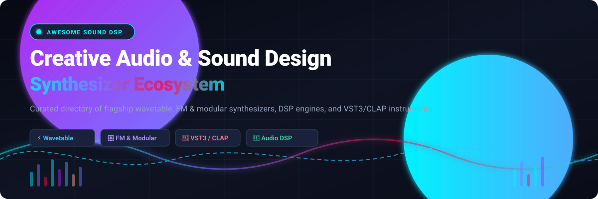

  

# 🎹 Awesome Creative Audio & Sound Design Synthesizers 🎛️

  
  
  
  
  
  
  
  

> 🚀 **The definitive curated directory of commercial hosted platforms and open-source software synthesizers, Eurorack modular studios, audio DSP frameworks, and VST3/CLAP/LV2 instruments for modern sound designers, music producers, and audio DSP developers.**

---

## 📑 Table of Contents

- [🌟 Sector Overview & Market Dynamics](#-sector-overview--market-dynamics)
- [💼 SaaS & Commercial Hosted Platforms](#-saas--commercial-hosted-platforms)
- [🔓 Open-Source GitHub Projects](#-open-source-github-projects)
- [🛠️ Audio DSP Frameworks & Development Kits](#-audio-dsp-frameworks--development-kits)
- [📈 Star History](#-star-history)
- [🤝 How to Contribute](#-how-to-contribute)
- [💖 Support & Sponsorship](#-support--sponsorship)
- [⚖️ Disclaimer](#-disclaimer)

---

## 🌟 Sector Overview & Market Dynamics

The global market for creative audio synthesis, sound design software, and audio plugins is valued between **$1.4 billion and $1.85 billion**, expanding at a healthy **7.2%–9.8% CAGR toward $2.7B+** as in-the-box electronic music production, procedural game audio, and home studio workflows rapidly proliferate.

The sector demonstrates a **moderately fragmented** competitive dynamic:
- **Commercial Frontrunners**: Established leaders such as **Arturia**, **Splice**, **Spectrasonics**, and **Native Instruments (under inMusic Brands)** command significant brand loyalty, extensive distribution channels, and comprehensive sound libraries.
- **Boutique Innovators & Open-Source Movement**: Producers and sound designers routinely maintain hybrid toolsets, chaining high-end boutique synthesizers (**Xfer Serum**, **u-he Diva**, **Kilohearts Phase Plant**) alongside powerful zero-cost, open-source software instruments (**Surge XT**, **Vital**, **VCV Rack**, **Cardinal**). This prevents single-vendor monopolization and fuels ongoing digital signal processing (DSP) innovation.

---

## 💼 SaaS & Commercial Hosted Platforms

| 🏷️ Platform / Synthesizer | 💳 Pricing | 🎁 Free Tier / Trial Limits | 📊 Company Scale (Revenue / Valuation) | 📝 Description |
| :--- | :--- | :--- | :--- | :--- |
| **[Splice Sounds & Plugins](https://splice.com)** | Starting at $12.99/mo (Sounds+ plan) or rent-to-own installments from $9.99/mo | 14-day free trial on Sounds subscription (includes sample browsing credits; cancel anytime); rent-to-own plugins offer 3–14 day free trials before first installment | Valuation: ~$500M (Series D funding led by Goldman Sachs; >$100M annual revenue) | Cloud sound platform, cloud preset ecosystem, and rent-to-own distribution hub for flagship synths. |
| **[Pigments (Arturia)](https://arturia.com)** | Starting at $99.00 (promotional) / $199.00 regular perpetual license | Permanently free edition available via *Pigments Play* (capped at 100 presets with simplified Play View); full Pigments demo offers 20-minute sessions with save/export disabled | Revenue: ~$100M–$250M annual revenue (backed by EMZ Partners buyout/refinancing; 1M+ registered users) | Polychrome software synth combining wavetable, virtual analog, harmonic, granular, and modal engines. |
| **[Massive & Massive X (Native Instruments)](https://native-instruments.com)** | Starting at $149.00 perpetual (Massive) / $199.00 (Massive X), or included in Komplete bundles | 30-minute fully functional trial per session; automatically halts audio output after 30 minutes with save/export disabled | Revenue: ~€60M–€100M annual revenue (acquired by pro-audio conglomerate inMusic Brands in 2026) | Iconic wavetable and virtual-analog flagship synthesizers renowned for bass design and complex routing. |
| **[FM8 (Native Instruments)](https://native-instruments.com)** | Starting at $99.00 perpetual license (frequently $39–$49 on sale) | 30-minute fully functional trial per session; audio terminates after 30 minutes and requires session reload; patch saving disabled | Revenue: ~€60M–€100M annual revenue (part of Native Instruments under inMusic Brands) | Precision 6-operator FM synthesizer with interactive modulation matrix, morph square, and DX7 SysEx import. |
| **[Serum 2 / Serum (Xfer Records)](https://xferrecords.com)** | Starting at $189.00 perpetual license (or $9.99/mo Rent-to-Own on Splice) | Unlimited days evaluation demo; fully unlocked feature set but automatically stops producing sound after 15 minutes per session | Revenue: Estimated $10M–$20M+ cumulative lifetime sales (independent boutique studio by Steve Duda & deadmau5) | Industry-defining wavetable synth featuring real-time wavetable manipulation and clean interpolation. |
| **[Phase Plant (Kilohearts)](https://kilohearts.com)** | Starting at $9.99/mo (Kilohearts Subscription) or $199.00 perpetual license | 10-day fully functional, unrestricted trial across all generators, snapins, and modulation modules | Revenue: Estimated $5M–$15M annual revenue (independent boutique developer based in Sweden) | Semi-modular sound design powerhouse combining analog, wavetable, granular, and sampler generators with snapin FX. |
| **[Omnisphere (Spectrasonics)](https://spectrasonics.net)** | Starting at $499.00 perpetual license | No public free trial or free tier; 4-day temporary emergency evaluation authorization mode upon installation with intermittent noise | Revenue: Estimated $15M–$30M annual revenue (privately held category leader by Eric Persing) | Flagship hybrid synth combining 65GB+ sample libraries, multi-engine DSP synthesis, and hardware integration. |
| **[Diva (u-he)](https://u-he.com)** | Starting at €179.00 perpetual license | Indefinite free evaluation; fully functional without time-out, but injects periodic vinyl crackle/static noise every minute | Revenue: Estimated $3M–$8M annual revenue (independent boutique studio Heckmann Audio GmbH, Berlin) | Analog-modeled synth recreating classic filters, oscillators, and envelopes with zero-delay feedback. |
| **[Sylenth1 (LennarDigital)](https://lennardigital.com)** | Starting at €139.00 (~$149.00) perpetual license (or €9.95/mo rent-to-own) | Unlimited days evaluation demo; plays audio reminder tone every 60 seconds, half of modulation slots disabled, max 128 presets | Revenue: Estimated $2M–$5M annual revenue (privately owned boutique studio Lennardigital B.V., Netherlands) | CPU-efficient virtual-analog VST celebrated for unison oscillators, warmth, and classic dance leads/pads. |
| **[Spire (Reveal Sound)](https://reveal-sound.com)** | Starting at $189.00 perpetual license (frequently $99–$129 on sale) | Indefinite free evaluation; fully functional audio engine and patch saving, but injects a burst of white noise every 30 seconds | Revenue: Estimated $2M–$5M annual revenue (privately held boutique music software developer) | Polyphonic synth combining 4 polymorphic multimode oscillators with dual filters and mastering effects. |
| **[Vital (Vital Cloud Tier)](https://vital.audio)** | Starting at $5.00/mo (Subscription) or $25.00 (Plus) / $80.00 (Pro) | Vital Basic is free forever; includes complete synthesis engine, full modulation, 75 presets, 25 wavetables, limited text-to-wavetable | Revenue: Estimated $1M–$3M annual revenue (independent project created by Matt Tytel) | Visual spectral warping wavetable synth with cloud-synced text-to-wavetable AI and preset marketplace. |

---

## 🔓 Open-Source GitHub Projects

Curated list of open-source synthesizers, Eurorack studios, and sound design instruments sorted in descending order by GitHub star count:

- 🌐 **[Tone.js](https://github.com/Tonejs/Tone.js)**   
  A Web Audio framework for making interactive music, generative synths, and web-native sound design in the browser.

- 🎛️ **[Bespoke Synth](https://github.com/BespokeSynth/BespokeSynth)**   
  Open-source software modular synthesizer and live-patching sound design DAW built with visual patch cables and node-based signal routing.

- 🔌 **[VCV Rack](https://github.com/VCVRack/Rack)**   
  The virtual Eurorack studio environment enabling open-source hardware-accurate modular synthesis, CV routing, and custom module development.

- 🌊 **[Surge XT](https://github.com/surge-synthesizer/surge)**   
  Flagship open-source hybrid synthesizer (VST3/CLAP/LV2/Standalone) featuring 12 oscillator algorithms, dual filter configurations, and comprehensive modulation.

- 📻 **[Dexed](https://github.com/asb2m10/dexed)**   
  Multi-platform, multi-format 6-operator FM synthesizer plugin modeled directly on the Yamaha DX7, supporting full SysEx cartridge reading and writing.

- 🎚️ **[Cardinal](https://github.com/DISTRHO/Cardinal)**   
  Self-contained open-source virtual modular synthesizer plugin (VST3/CLAP/LV2) packaging over 1,000 modules with zero external server dependencies.

- 🪐 **[Helm](https://github.com/mtytel/helm)**   
  Cross-platform polyphonic synthesizer with real-time visual animated modulation, 32-step sequencer, and dual oscillators.

- 🔮 **[Vital](https://github.com/mtytel/vital)**   
  GPLv3 open-source spectral warping wavetable synthesizer featuring animated visual feedback, custom wavetable editing, and a 3D spectrogram.

- 📊 **[Pure Data](https://github.com/pure-data/pure-data)**   
  Foundational open-source visual real-time computer music environment and dataflow language for audio synthesis and algorithmic composition.

- 📜 **[Csound](https://github.com/csound/csound)**   
  Battle-tested programmable audio synthesis and signal processing system providing hundreds of unit generators for rigorous acoustic design.

- 🎧 **[Airwindows](https://github.com/airwindows/airwindows)**   
  Extensive collection of open-source MIT-licensed audio DSP effects, saturation algorithms, and analog-style sound processors.

- 🎛️ **[ZynAddSubFX](https://github.com/zynaddsubfx/zynaddsubfx)**   
  Real-time software synthesizer combining additive (`ADsynth`), subtractive (`SUBsynth`), and Fourier pad (`PADsynth`) synthesis architectures.

- ⚡ **[Odin 2](https://github.com/TheWaveWarden/odin2)**   
  24-voice polyphonic open-source synthesizer blending analog-modeled oscillators, wavetables, FM, and chiptune generators with vintage filter emulations.

- 📦 **[Shortcircuit XT](https://github.com/surge-synthesizer/shortcircuit-xt)**   
  Open-source multi-sampler and sample-manipulation synthesizer engine developed by the Surge Synth Team.

- 🎲 **[Stochas](https://github.com/surge-synthesizer/stochas)**   
  Open-source polyrhythmic stochastic step sequencer plugin for algorithmic pattern design and expressive synth modulation.

- 👾 **[Klystrack](https://github.com/kometbomb/klystrack)**   
  Chiptune tracker and synth workstation featuring an integrated subtractive synthesizer engine with FM, noise, and ring modulation.

- 🧪 **[Soma](https://github.com/kai-jungsthoefel/soma)**   
  Open-source experimental audio and parametric sound design workstation tailored for generative synthesis and AI-assisted modulation.

- 🧩 **[Audible Instruments](https://github.com/VCVRack/AudibleInstruments)**   
  Official open-source VCV Rack modular ports of Mutable Instruments hardware Eurorack modules (Braids, Clouds, Rings, Plaits).

- 🔊 **[Monique](https://github.com/surge-synthesizer/monique-monosynth)**   
  Open-source aggressive, morphing bass and lead monosynth maintained by the Surge Synth Team.

- 🐟 **[Tunefish 4](https://github.com/paynebc/tunefish)**   
  Ultra-lightweight open-source virtual analog synthesizer based on an additive wavetable generator originally developed for 64k demoscene productions.

- 🎹 **[OB-Xd](https://github.com/reales/OB-Xd)**   
  Virtual-analog synthesizer based on the Oberheim OB-X, delivering continuous filter blending and polyphonic detuning.

---

## 🛠️ Audio DSP Frameworks & Development Kits

For developers creating custom sound design tools, synthesizers, and audio plugins:

- 💻 **[JUCE](https://github.com/juce-framework/JUCE)**   
  Industry-standard cross-platform C++ application framework for desktop and mobile audio software, VST3, AU, CLAP, and LV2 synthesizer plugins.

- 🔊 **[SuperCollider](https://github.com/supercollider/supercollider)**   
  High-performance real-time audio synthesis server (`scsynth`), programming language, and IDE for algorithmic composition and generative sound design.

- ⚙️ **[Faust](https://github.com/grame-cncm/faust)**   
  Functional DSP programming language for real-time sound synthesis that compiles directly into C++, Rust, WebAssembly, and VST3 plugins.

- 🧪 **[Elementary Audio](https://github.com/elemaudio/elementary)**   
  Functional JavaScript/TypeScript audio DSP library and runtime for developing high-performance web synthesizers and native audio applications.

- 🏗️ **[Pamplejuce](https://github.com/sudara/pamplejuce)**   
  Modern C++ audio plugin CI/CD template powering JUCE 8, Catch2, Pluginval, and automated multi-platform builds for synthesizer developers.

- 🎼 **[Surge Tuning Library](https://github.com/surge-synthesizer/tuning-library)**   
  Header-only C++ library for microtonal tuning, Scala (scl/kbm) parsing, and MTS-ESP frequency evaluation used in modern synth development.

---

## 📈 Star History

---

## 🤝 How to Contribute

Contributions are warmly encouraged! To propose a new software synthesizer, DSP engine, or commercial sound platform:

1. 🍴 **Fork the repository** on GitHub.
2. 🌿 **Create a descriptive feature branch** (`git checkout -b add-my-synthesizer`).
3. 📝 **Add or edit entries in `README.md`** following the existing format:
   - Provide the project name and official link.
   - Include a concise 1–2 sentence description of its synthesis capabilities and plugin formats (VST3, CLAP, AU, LV2).
   - Specify whether it is SaaS/hosted, commercial, or open-source.
4. 🚀 **Submit a Pull Request** with a brief summary of why the tool is valuable for sound designers and producers.

⭐ *Don't forget to star the repository if you found it useful!*

---

## 💖 Support & Sponsorship

If this curated directory has helped you discover new sound design synthesizers, build modular patches, or develop audio DSP instruments, consider supporting the ongoing maintenance of this project:

- ⭐ **Star this repository** to boost visibility and help other musicians and engineers discover it.
- 🍴 **Fork & Share** the repo across your networks on X/Twitter, LinkedIn, Discord, and Reddit.
- ☕ **Buy me a coffee / Sponsor on GitHub Sponsors**:  
  Support my open-source work directly via the [GitHub Sponsor Dashboard](https://github.com/sponsors/ishandutta2007). Your sponsorship helps keep these ecosystem lists actively researched, verified, and continuously up to date!

---

## ⚖️ Disclaimer

- This is an independent **community-curated directory** intended for educational and reference purposes. It is not an endorsement or official affiliation with any mentioned companies or trademarks.
- `Vital` maintains a dual offering: a GPLv3 open-source source tree as well as proprietary commercial preset/cloud tiers. Always review individual software licenses and EULAs before deploying in commercial audio productions or embedding in software plugins.
- 🔊 **Hearing Safety Warning**: Always insert a brickwall peak limiter on your master audio channel when experimenting with resonant modular filters, self-oscillating delay lines, or experimental FM feedback loops to protect your hearing and studio monitors.

---

  <b>Crafted with ❤️ for sound designers, electronic music producers, game audio developers, and audio DSP engineers.</b> 
  Let's make creative audio synthesis and sound design more open, expressive, and accessible to creators worldwide.

